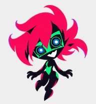
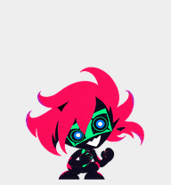
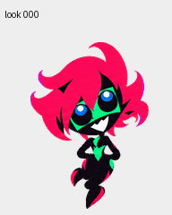
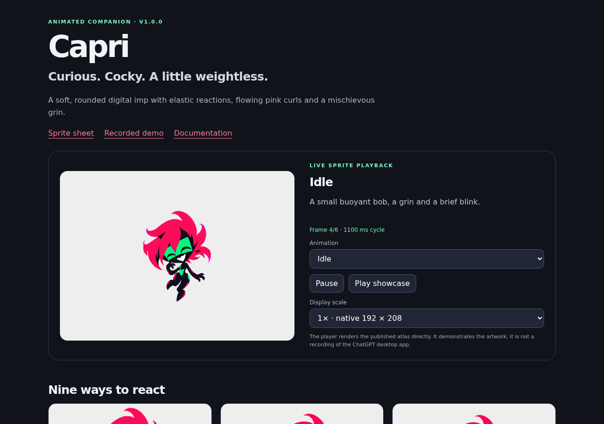
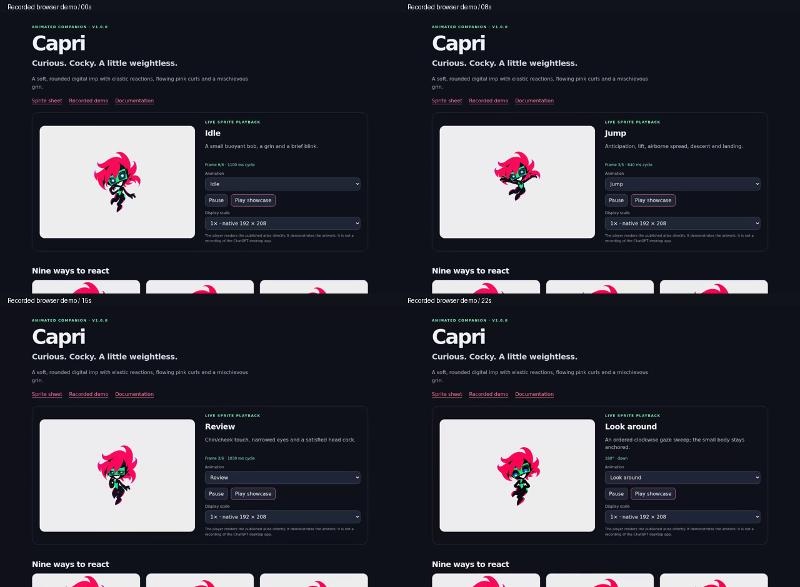
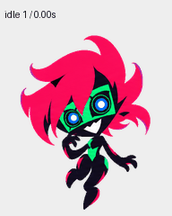
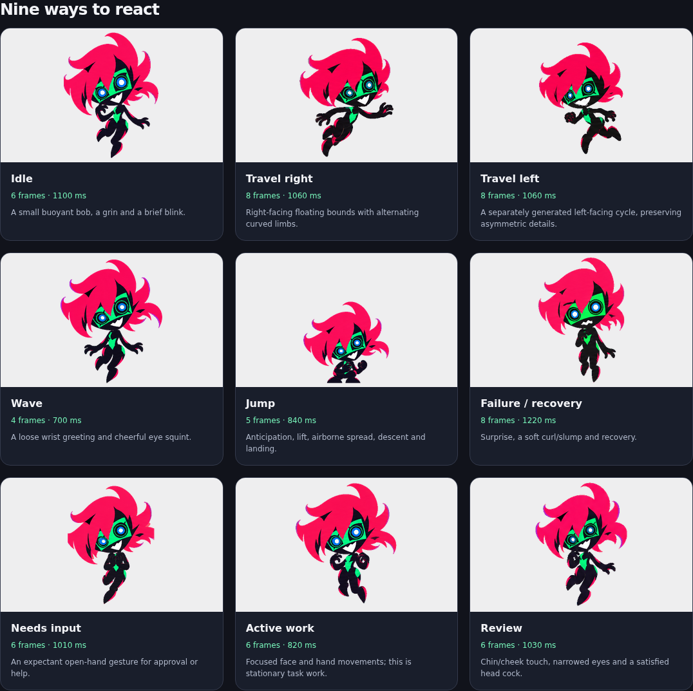
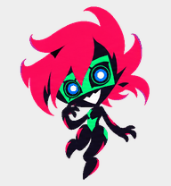
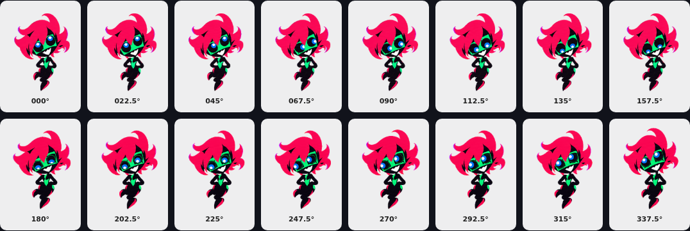

# Capri — animated digital companion

A soft, rounded fan-made Capri companion: flowing hot-pink curls, a tiny flexible body, expressive green-and-blue eyes and a mischievous grin.

**9 animation states · 16 gaze directions · transparent v2 sprite sheet · recorded playback demo**

  

## Download and use

- **[Download the complete release](https://github.com/Zack24680/capri-pet/releases/latest)** for artwork, motion previews, source strips, screenshots and validation.
- **[V2 sprite sheet](assets/capri.png)** — `1536 × 2288`, nine animation rows plus sixteen gaze poses. Choose **Raw / Download raw file** on GitHub to save the original PNG.
- **[V1 compatibility sheet](assets/capri-v1.png)** — `1536 × 1872`, the same first nine rows, without gaze poses. Use this only when your importer explicitly requires the older nine-row layout.
- **[Watch the recorded browser demo](media/capri-demo.mp4)** · [WebM capture](media/capri-demo.webm) · [compact animation video](media/all-states.mp4)

Use your ChatGPT/Codex client's custom-pet import or upload flow and supply the matching transparent sprite sheet. Client support and storage differ: some clients accept uploaded sheets, while desktop custom-pet workflows may create locally installed pets. The [official Pets documentation](https://learn.chatgpt.com/docs/pets?surface=app) describes the available controls. The V2 sheet was accepted by the Pets integration used for this project; support in every client is not claimed.

`metadata.json` describes this project's atlas and playback timings. It is portable project metadata, **not** a guessed native `pet.json` configuration file. Installing the sprite does not install a character chatbot, dialogue script or voice.

## See Capri move



The [recorded demo](media/capri-demo.mp4) shows the included player displaying the exact published atlas in an isolated browser. It cycles through every standard state twice, then all sixteen gaze poses. This is a real browser playback recording, **not a capture of the ChatGPT desktop overlay** and not a runtime benchmark of that app.





| State | Frames | One cycle | What Capri does |
| --- | ---: | ---: | --- |
| Idle | 6 | 1,100 ms | Small buoyant bob, a grin and a brief blink. |
| Travel right | 8 | 1,060 ms | Right-facing floating bounds with alternating curved limbs. |
| Travel left | 8 | 1,060 ms | A separately generated left-facing cycle that preserves asymmetric details. |
| Wave | 4 | 700 ms | A loose wrist greeting and cheerful eye squint. |
| Jump | 5 | 840 ms | Anticipation, lift, airborne spread, descent and landing. |
| Failure / recovery | 8 | 1,220 ms | Surprise, a soft curl/slump and recovery. |
| Needs input | 6 | 1,010 ms | An expectant open-hand gesture for approval or help. |
| Active work | 6 | 820 ms | Focused face and hand movements while working in place. |
| Review | 6 | 1,030 ms | Chin/cheek touch, narrowed eyes and a satisfied head cock. |

These are the demonstration timings in this repository, not a promise that every host client plays the frames at the same speed. The atlas row named `running` means **active task work**; it is distinct from the two directional travel rows.



### Jump and gaze

 

The encoded jump reaches **38 px above the idle foot/base baseline** and returns with **0 px landing-baseline difference** under the validator's visible-pixel measurement. The dedicated loop preserves native `192 × 208` cell bounds.

Gaze directions use screen coordinates: **000 up, 090 right, 180 down, 270 left**. The body stays registered while the drawn face and eye graphics shift. The clockwise sweep includes restrained skyward curiosity as well as side glances.



Some near-cardinal intermediate glances are subtle. Five intermediate directions have reviewed semantic warnings; the final quality report also retains isolated negative-space and continuity warnings. These were reviewed and the final visual result was accepted. This is a **passed, reviewed asset**, rather than a claim of zero warnings. See [validation notes](docs/validation.md) and the actual [quality report](qa/quality-validation.json).

## Design and character

Capri keeps the reference character's confident, teasing energy, flashes of impatience and quieter curiosity. The adaptation deliberately uses broad curved pink shapes, a large head, a small pliant body, loose wrists and readable expressions. It avoids the earlier rigid armored interpretation.

The mouth is a single changing white glyph, without individually divided teeth. Squints, winks, curls and cheek/chin gestures carry the personality. Detached glitch fragments and transient duplicate eyes from the source footage were omitted for readability at pet size.

[Character and motion notes](docs/character-and-motion.md) explain what came from the supplied footage and what was synthesized for the pet. The artwork does not reproduce an exhaustive personality or vocabulary model.

## Format and verification

| Property | Published V2 asset |
| --- | --- |
| Image | Transparent RGBA PNG, `1536 × 2288` |
| Grid | 8 columns × 11 rows; each cell `192 × 208` |
| Required artwork | 73 populated cells; 15 unused cells fully transparent |
| Standard row counts | `6, 8, 8, 4, 5, 8, 6, 6, 6` |
| Gaze rows | Eight cells each, in fixed clockwise order |
| Encoded size | 2,414,151 bytes |
| SHA-256 | `cfd4a14f51dde57049bad38da9cd5e65f5434466256edfa339d0ac5f3f4d0ae6` |

The final sheet passed the bundled structural validator, the pet quality gate and the Pets preflight. Name/description and successful creation were separately verified in the owner's collection; private account identifiers and upload sessions are not part of this repository.

The nine-state GIF contains **114 playback frames over 17.68 seconds**, showing each cycle twice. The look GIF contains **16 frames over 3.52 seconds**. The smaller all-state MP4 is a re-encoding of the GIF; container timing differs slightly. Browser screenshots and the larger recorded demo come from the included static player. File sizes and media properties are reported in [media inventory](docs/media-inventory.md). No CPU, memory, engine latency or host-app FPS benchmark is claimed.

To verify the download locally:

```sh
python3 -m pip install Pillow
python3 scripts/verify_assets.py
```

To recreate the isolated browser screenshots and recording (optional):

```sh
python3 -m pip install playwright
python3 -m playwright install chromium
python3 scripts/capture_demo.py
```

The capture script uses an isolated browser context and a loopback-only static server. The server closes when capture finishes. See [validation notes](docs/validation.md) for the recorded checks and limitations.

## Repository map

- `assets/` — final V2 PNG and lossless V1 compatibility crop.
- `media/` — GIFs, MP4/WebM recordings, browser screenshots, contact sheets and labeled stills.
- `source/` — the selected generated base and state strips, with their original yellow chroma background.
- `preview/`, `index.html` — the local sprite player.
- `docs/`, `qa/`, `scripts/` — motion/provenance documentation, portable evidence reports and verification/capture tools.

Only selected approved artwork is published. Rejected designs, private work logs, browser profiles, credentials and account-specific pet records are excluded. Source strips are production inputs; use the final transparent PNG when importing the pet.

## Provenance and attribution

Artwork was generated with OpenAI's built-in image generator. Generated pixels were extracted, registered, assembled and cleaned with the bundled Pets tools. Preview recording and screenshots use Playwright; video encoding uses FFmpeg. No alternate image or video-generation provider was used.

The source character references are Capri / Project Capricorn, as identified by the user, from *Cyberpunk: Edgerunners 2*. This is an unofficial fan-made adaptation. The source character and franchise rights remain with their respective owners; this repository does not grant a license over them. No official source footage, episode transcript or user browser/account data is redistributed here.

Reference links and exact inspected intervals are listed in [source notes](docs/character-and-motion.md). This repository does not claim official affiliation or an official character model sheet.
