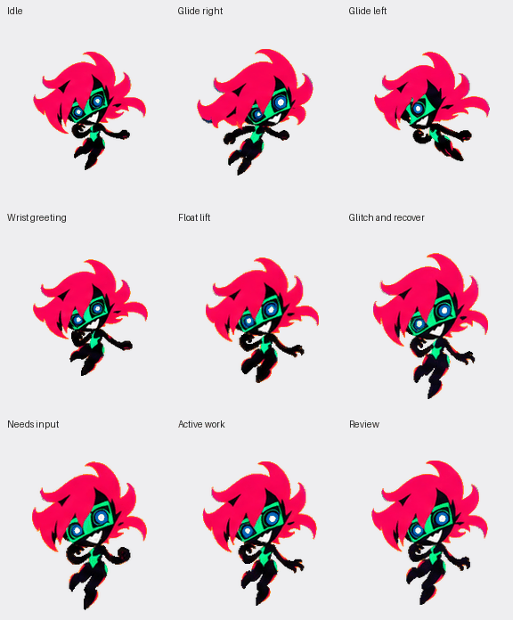

# Capri — a custom pet for Codex

A soft, rounded fan-made Capri for Codex desktop: flowing hot-pink curls, a tiny flexible body, expressive digital eyes and a mischievous grin.

**[Download Capri v2.0.0 for Codex](https://github.com/Zack24680/capri-pet/releases/download/v2.0.0/capri-60fps.zip)**

**9 actions · 60 distinct frames per action · 60 fps animation tracks · brief glitch expressions**

The GIF shows the full one-second action cycles at 50 fps. The installed pet's tracks use all 60 frames at 60 fps; actual display cadence depends on Codex and your device.

## Install in Codex

1. Download **`capri-60fps.zip`** above and extract it.
2. Place the included **`capri` folder** in your Codex pets folder, usually `%USERPROFILE%\.codex\pets` on Windows. The result should be `%USERPROFILE%\.codex\pets\capri\pet.json`, with `spritesheet.webp` beside it.
3. In Codex desktop, open **Settings > Pets**, select **Refresh**, and choose **Capri**. Use `/pet` to show her.

Requires a Codex desktop build with support for custom pet animation tracks. The owner has tried this revision and accepted its appearance; other app versions may have different limits.

**Updating an existing Capri?** Back up her folder first. To preserve an existing pet ID and custom metadata, attach the ZIP in a local Codex task with access to that folder and send:

> Update my existing Capri using the supplied artwork and per-state animation tracks. Back up the original files, preserve her ID and other metadata, and verify that the replacement loads. Do not regenerate the artwork.

## How Capri moves

Capri stays suspended rather than bouncing against a floor. Small wrist movements, head tilts, changing eye graphics and delayed curls carry the action. Glitches briefly offset parts of the drawing, then return to a clean pose.

| Action | Movement |
| --- | --- |
| Idle | Quiet hover, small glance and cheek gesture. |
| Glide right | Right-facing lean with loose trailing limbs. |
| Glide left | Separately drawn left-facing glide that keeps her asymmetry. |
| Greeting | A small wrist flourish and teasing digital wink. |
| Floating lift | Shallow levitation and return, with curled legs and no grounded push-off. |
| Failure / recovery | A stronger brief glitch, compressed expression and composed recovery. |
| Needs input | An expectant open palm and questioning look. |
| Active work | Focused hand and wrist movements near the chest. |
| Review | A cheek gesture, narrowed eyes and small head adjustment. |

Each action contains 60 distinct drawings over one second. Greeting, lift, failure and review return to idle; the remaining states loop. The atlas also preserves sixteen original gaze drawings; pointer-driven gaze mapping is not verified for this package.

## Files and validation

The download contains the native pet manifest, a transparent lossless WebP atlas, installation notes and checksums. It needs no account, API key or build step.

The new native format replaces the old single-PNG installation flow. [The v1.0.0 release](https://github.com/Zack24680/capri-pet/releases/tag/v1.0.0) remains available for clients using that earlier format.

[Validation notes](docs/validation.md) describe the measured frame counts, timing, atlas checks and compatibility limits. [Character and motion notes](docs/character-and-motion.md) cover the references and adaptation; [media inventory](docs/media-inventory.md) lists the current GIFs.

## Attribution

This is an unofficial fan-made adaptation of Capri / Project Capricorn from *Cyberpunk: Edgerunners 2*. Character and franchise rights remain with their respective owners; this repository does not grant a license over them.

Artwork was generated with OpenAI's built-in image generator. All new poses and glitch artwork come from those generated drawings; fitting, placement and encoding are documented in the validation notes.
